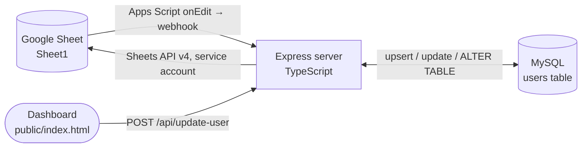

# Sheet ↔ DB Sync: High-Level Design

A two-way sync engine between Google Sheets and MySQL: edits in the sheet update the database, edits from a dashboard update the database and the sheet, and new sheet columns are added to the database automatically. For code-level detail see the [Low-Level Design](lld.md).

## 1. System context

## 2. Flows

| Direction | Path |
|---|---|
| Sheet → DB | Apps Script `onEdit` trigger posts the row to `/webhook/sheet-update` → schema check → MySQL upsert |
| Dashboard → DB → Sheet | Dashboard posts to `/api/update-user` → schema check → MySQL update or insert → the matching sheet row is rewritten |

## 3. Key ideas

| Idea | How |
|---|---|
| Row identity | Every row has a `sync_id` (first sheet column, unique key in MySQL) |
| Schema drift | Any new field is added to `users` as a `TEXT` column before writing |
| Column mapping | Sheet header row decides the order of values written back |
| Loop prevention | Writes pushed to the sheet by the API are kept from re-triggering the sheet webhook |

## 4. Tech

| Item | Choice |
|---|---|
| Server | Node.js, Express, TypeScript |
| Database | MySQL via `mysql2/promise` pool (15 connections, SSL) |
| Sheets | `googleapis` with a service-account key file |
| Hosting | Vercel config included |

## 5. Known limits

The webhook and update endpoints have no authentication, and any new field name becomes a new column, so the server should only be reachable by trusted callers.
