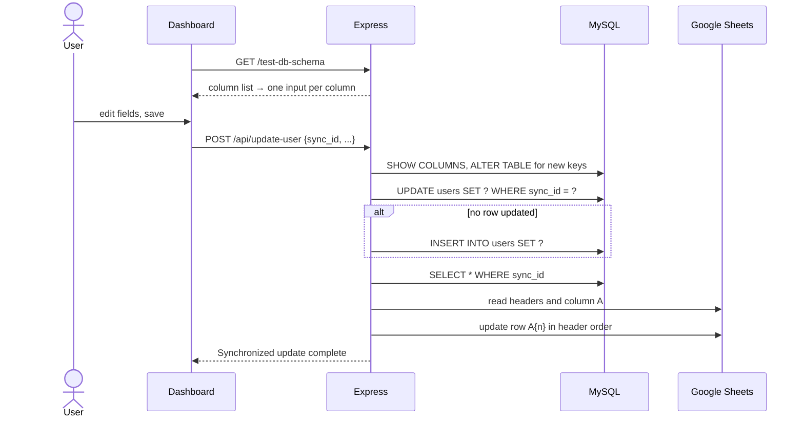

# Sheet ↔ DB Sync: Low-Level Design

For the big picture see the [High-Level Design](hld.md).

## 1. Endpoints

| Method | Route | Body | Behavior |
|---|---|---|---|
| GET | `/` | | Serves the dashboard (`public/index.html`) |
| POST | `/webhook/sheet-update` | row object with `sync_id` | `ensureSchemaMatches`, then `INSERT … ON DUPLICATE KEY UPDATE` |
| POST | `/api/update-user` | fields with `sync_id` | `ensureSchemaMatches`, `UPDATE users SET ? WHERE sync_id = ?`, insert if no row matched, then `syncDbToSheet` |
| GET | `/test-db-schema` | | Current `users` column names (the dashboard builds its inputs from these) |

## 2. Functions

| Function | Behavior |
|---|---|
| `getSpreadsheetId()` | Reads `SPREADSHEET_ID` or throws |
| `ensureSchemaMatches(table, data)` | `SHOW COLUMNS`, then `ALTER TABLE … ADD COLUMN ?? TEXT` for each unknown key (except `id`, `updated_at`) |
| `syncDbToSheet(sync_id)` | Loads the DB row, reads header row `Sheet1!1:1` and column `Sheet1!A:A`, finds the row whose first cell is `sync_id`, writes values in header order with `USER_ENTERED` |

## 3. Dashboard update sequence

## 4. Configuration

| Variable / file | Purpose |
|---|---|
| `DB_HOST`, `DB_PORT` (3306), `DB_USER`, `DB_PASSWORD`, `DB_NAME` | MySQL |
| `SPREADSHEET_ID` | Target spreadsheet (tab `Sheet1`) |
| `service-account.json` | Google service account key with Sheets scope (never commit it) |
| `PORT` | Default 3000 |
